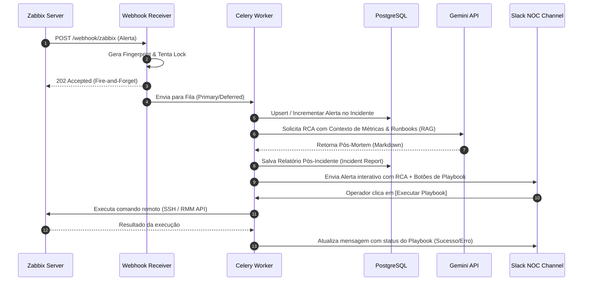

# Spec-001: AIOps Platform — n.infraops

## 1. Introdução
Esta especificação define o comportamento funcional e não-funcional da plataforma **n.infraops**, uma solução inteligente de gerenciamento de eventos e automação voltada ao monitoramento corporativo via Zabbix.

---

## 2. Visão Geral do Fluxo
A plataforma opera recebendo alertas do Zabbix de forma assíncrona, aplicando pipelines de deduplicação e correlação, gerando análises de causa raiz (RCA) assistidas por IA, e acionando playbooks automatizados de remediação.

---

## 3. As 7 Capacidades do Sistema

### 3.1. Correlação & Deduplicação de Alertas
*   **Deduplicação:** Alertas que possuem o mesmo par `(host_id, trigger_id)` geram o mesmo fingerprint SHA-256 e são agrupados no mesmo incidente ativo.
*   **Correlação Temporal:** Alertas no mesmo host que disparam dentro de uma janela de 5 minutos são vinculados ao mesmo incidente macro para evitar a inundação do canal do NOC.

### 3.2. Redução de Ruído
*   **Inibição:** Se um host dispara um alerta crítico de `Host Unreachable`, alertas subsequentes de serviços (ex: Apache down, Agent unreachable) são vinculados e silenciados de notificações imediatas.
*   **Manutenção:** Integração de via dupla para sincronizar períodos de manutenção e evitar falsos alarmes durante deploys planejados.

### 3.3. Root Cause Analysis (RCA) com IA
*   **RAG sobre Runbooks:** Busca semântica usando pgvector no banco de incidentes passados e runbooks em markdown para prover contexto adicional à IA.
*   **Gemini Integration:** Envia logs, métricas agregadas e dados de similaridade para o Gemini 2.5 Flash, que formula hipóteses da causa raiz e propõe ações corretivas imediatas.

### 3.4. Detecção de Anomalias (Machine Learning)
*   **Robust Z-Score (Mediana + MAD):** Evita falsos alarmes em distribuições de métricas assimétricas (ex: surtos sazonais de CPU).
*   **Feedback ao Zabbix:** Permite exportar scores de anomalias calculados de volta ao Zabbix via `history.push` para visualização em gráficos nativos.

### 3.5. Capacity Planning
*   **Previsão de Esgotamento:** Analisa métricas de séries temporais de discos e recursos críticos para prever a data de esgotamento (100% de uso), recomendando ações de housekeeping.

### 3.6. Automação de Runbooks (Playbooks)
*   **Engine YAML:** Definição declarativa de passos de pré-verificação, execução de scripts, validação de saúde pós-execução e rollback.
*   **Safety Gates:** Limite máximo de execuções concorrentes por hora, restrição de blast radius a 5% da frota, e dry-run habilitado por padrão.

### 3.7. ChatOps & Timeline
*   **Slack/WhatsApp:** Painel interativo permitindo que operadores aprovem execuções de playbooks diretamente do chat, visualizem timelines históricas e abram chamados.
