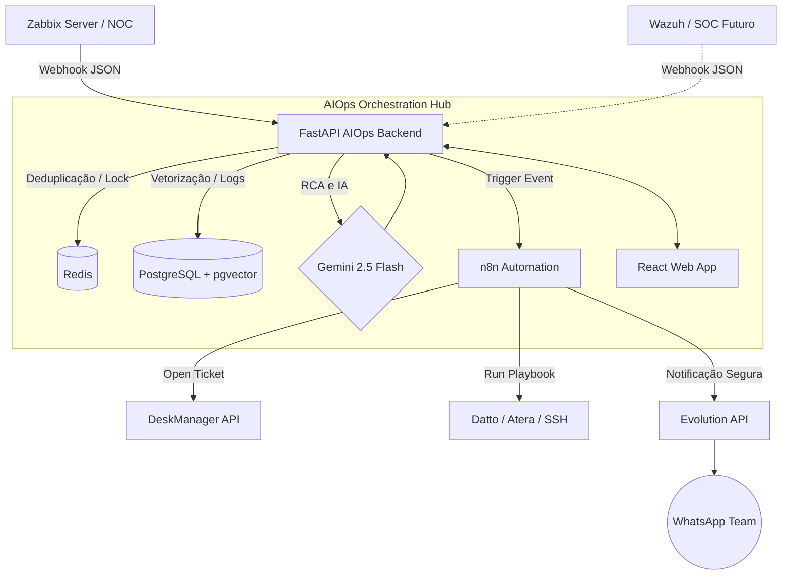

# 🛡️ zabbix.ness — AIOps Platform

[](https://opensource.org/licenses/MIT)
[](https://www.python.org/downloads/release/python-3120/)
[](https://reactjs.org/)
[](https://fastapi.tiangolo.com/)
[](https://www.ansible.com/)
[](https://www.terraform.io/)

**Monorepo Enterprise da ness.** — Infraestrutura Zabbix (NOC) + Plataforma AIOps Multi-Tenant (n.infraops).

---

## 📖 Table of Contents
- [Arquitetura AIOps](#-arquitetura-aiops)
- [Estrutura do Projeto](#-estrutura)
- [Quick Start](#-quick-start)
- [Componentes & Módulos](#-componentes)
- [Ambiente e Custos](#-ambiente)
- [Atualizações e Contribuição](#-atualizações-e-contribuição)

---

## 🏛️ Arquitetura AIOps

O diagrama abaixo ilustra o fluxo de dados desde a detecção de anomalias até a orquestração e notificação.



---

## Estrutura

```
zabbix.ness/
│
├── infra/                   # 🏗️ Infraestrutura & Migração
│   ├── terraform/           #    Provisioning Contabo (VPS + Object Storage)
│   ├── ansible/             #    Setup Zabbix 7.0 LTS (MariaDB, Apache, hardening)
│   ├── scripts/             #    Migração Azure → Contabo (6 scripts)
│   └── docs/                #    Runbook operacional + checklist de migração
│
├── app/                     # 🧠 n.infraops — Plataforma AIOps
│   ├── backend/             #    Python 3.12 + FastAPI + Celery
│   │   ├── app/             #    Código-fonte (API, workers, ML, integrações)
│   │   ├── sql/             #    DDL do banco (assets, incidentes, reports)
│   │   ├── postgresql.conf  #    Tuning para 8 GB RAM
│   │   └── requirements.txt
│   ├── docker-compose.yml   #    Stack completa (API + Workers + PG + Redis + n8n)
│   ├── Dockerfile           #    Build da API (slim, non-root)
│   └── .env.example         #    Template de variáveis
│
└── .agents/                 #    Skills do agente de desenvolvimento
```

---

## Componentes

### `infra/` — Infraestrutura

Provisionamento e migração do ambiente de monitoramento:

| Componente | Descrição |
|---|---|
| **Terraform** | VPS Contabo (Storage VPS 40 + Object Storage 250 GB) |
| **Ansible** | Zabbix 7.0 LTS all-in-one (MariaDB 10.11, Apache, hardening) |
| **Scripts** | 6 scripts de migração Azure → Contabo com validação |
| **Docs** | Runbook operacional e checklist de migração |

### `app/` — n.infraops

Plataforma AIOps que transforma alertas brutos do Zabbix em inteligência operacional:

| Módulo | Descrição |
|---|---|
| **Webhook + Lock** | FastAPI `/webhook/zabbix` com lock distribuído Redis (SET NX EX) |
| **Correlação** | Fingerprint SHA-256 agrupa alertas em incidentes |
| **Sanitização** | 7 regex patterns mascaram IPs, senhas, tokens antes do LLM |
| **Anomalias** | Z-Score Robusto (MAD) detecta desvios antes dos thresholds estáticos |
| **Post-Mortem** | Gemini 2.5 Flash gera relatório Markdown com RCA, timeline, blast radius |
| **Ticketing** | n8n abre tickets no DeskManager automaticamente |
| **WhatsApp** | Alertas read-only via Evolution API (sem chatbot, CISO-approved) |
| **RMM Factory** | Execução de playbooks via Datto, Atera ou SSH/Netmiko |

---

## Quick Start

### Infraestrutura (Zabbix)

```bash
# 1. Provisionar VPS
cd infra/terraform
cp environments/prod.tfvars .auto.tfvars  # preencher credenciais
terraform init && terraform apply

# 2. Configurar Zabbix
cd ../ansible
ansible-playbook -i inventory/hosts.yml playbooks/site.yml
```

### Plataforma (n.infraops)

```bash
# 1. Configurar variáveis
cd app
cp .env.example .env  # preencher credenciais

# 2. Subir stack
docker compose up -d

# 3. Verificar
curl http://localhost:8000/docs  # Swagger UI
```

---

## Ambiente

| Serviço | Recurso | Custo |
|---|---|---|
| **Zabbix** | Storage VPS 40 (8 vCPU, 30 GB RAM, 1.2 TB SSD) | €20/mês |
| **n.infraops** | Storage VPS 20 (3 vCPU, 8 GB RAM, 400 GB SSD) | €6/mês |
| **Backup** | Object Storage 250 GB (S3-compatible) | €2.49/mês |
| **IA** | Gemini 2.5 Flash API | ~€10/mês |
| **Total** | | **€38.49/mês** |

---

## Stack

| Camada | Tecnologia |
|---|---|
| Backend | Python 3.12, FastAPI, Celery |
| Banco | PostgreSQL 16 + TimescaleDB + pgvector |
| Cache/Queue | Redis 7 |
| Workflows | n8n (self-hosted) |
| LLM | Gemini 2.5 Flash |
| Ticketing | DeskManager API |
| WhatsApp | Evolution API |
| RMM | Datto, Atera, SSH/Netmiko |
| Frontend | Next.js 14+ (em desenvolvimento) |

---

## 🔄 Atualizações e Contribuição

Este projeto segue diretrizes rigorosas de código e segurança. Para garantir que seu ambiente esteja sempre atualizado com as melhores práticas:

- **[UPGRADING.md](UPGRADING.md):** Guia detalhado de como aplicar patches de segurança, atualizar dependências Node/Python e gerenciar migrações de banco de dados.
- **[CONTRIBUTING.md](CONTRIBUTING.md):** Padrões de commits (Conventional Commits), arquitetura do código e guias de Pull Requests.
- **[SECURITY.md](SECURITY.md):** Política de segurança, SLAs de correção e como reportar vulnerabilidades sem expô-las publicamente.
- **[CODE_OF_CONDUCT.md](CODE_OF_CONDUCT.md):** Nosso compromisso em manter um ambiente colaborativo e profissional.

---

## 📜 Licença

MIT — **ness.** 2026. Feito com rigor técnico para operações ininterruptas.
