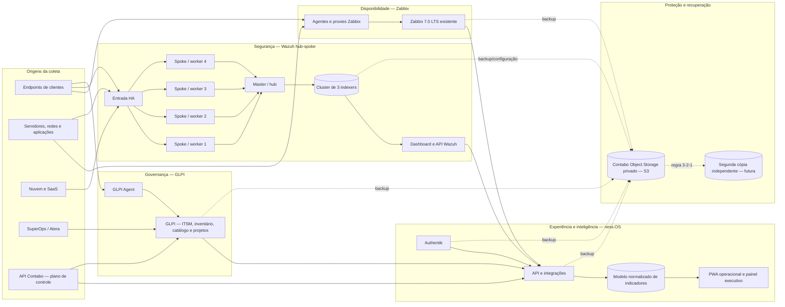
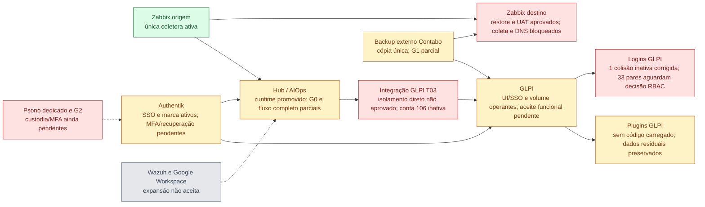

# Arquitetura oficial do ness.OS

- Estado: oficial
- Versão: 1.0
- Data: 22/08/2026
- Responsável: Ricardo Esper
- Decisões: ADR 0012 e ADR 0013

Este documento e a apresentação `docs/presentations/ness-os-infrastructure-5000-endpoints.html` formam a referência visual oficial do ness.OS. Diagramas anteriores permanecem apenas como histórico.

## Visão oficial

## Estado da implantação — 13/10/2026

Este diagrama mostra **estado comprovado**, não o desenho-alvo acima. Verde significa operação observada; amarelo, entrega parcial ou isolada; vermelho, gate bloqueado; cinza, expansão ainda não aceita. Uma seta indica dependência, não integração aprovada.

O destino Zabbix não está em produção; a origem segue coletando. No GLPI, a migração do volume e o retorno da rota pública não aprovam login nominal, ticket/anexo nem isolamento entre entidades. Os 33 pares de login ativos têm perfis divergentes, portanto a deduplicação em massa permanece suspensa. Os plugins não foram removidos. Evidências e próximos gates: [contexto canônico](../PROJECT_CONTEXT.md) e [plano master](../superpowers/plans/2026-10-12-ness-os-plano-master.md).

## Responsabilidade canônica

| Domínio | Sistema canônico | O que entrega ao ness.OS |
|---|---|---|
| Disponibilidade e capacidade | Zabbix | hosts, problemas, SLO, tendências, mapas e localização |
| Segurança | Wazuh | agentes, eventos qualificados, incidentes e postura |
| Governança e serviço | GLPI | ativos, tickets, catálogo, contratos, projetos e runbooks |
| Plano de controle do provedor | API Contabo | inventário de VPS, estado, ações, snapshots/backups e Object Storage |
| Experiência e indicadores | ness.OS | contexto unificado, correlação, PWA e visão executiva |
| Identidade | Authentik | SSO, MFA, grupos e sessões |

## Administração da plataforma

O papel `platform_admin` é o único autorizado a administrar tenants, integrações, credenciais, infraestrutura, políticas globais e ações do provedor. A atribuição inicial é nominal e restrita a:

- Ismael Araujo;
- Rogerio Salerno;
- Ricardo Esper.

O grupo deve nascer no Authentik, ser consumido pelo backend e nunca ser inferido apenas pelo menu da interface. Toda ação privilegiada deve exigir autorização no servidor, MFA e trilha de auditoria. Clientes e demais equipes recebem papéis de consumo ou operação delegada por tenant, sem herdar `platform_admin`.

## CDN

Não foi identificado um serviço de CDN nativo da Contabo no catálogo/API consultados. CDN é opcional e fica somente diante dos ativos estáticos públicos da PWA e, se comprovado em piloto, como proteção HTTP. Não recebe tráfego de agentes Zabbix/Wazuh, APIs internas, sessões do GLPI/Authentik ou backups. Não entra na compra-base do projeto.

## Backup S3

O Contabo Object Storage será a primeira cópia externa, acessada diretamente pela API S3 — nunca montada como disco do banco ou dos indexers. Padrão inicial de buckets privados:

- `ness-os-zabbix-prod`;
- `ness-os-aiops-prod`;
- `ness-os-glpi-prod`;
- `ness-os-wazuh-prod`;
- `ness-os-auth-prod`;
- `ness-os-evidence`.

Cada produtor terá credencial exclusiva, criptografia antes do envio, manifesto, SHA-256, marcador `COMPLETED`, versionamento/imutabilidade e lifecycle. A implantação continua bloqueada até existirem endpoint, access key, secret key e buckets reais; credenciais não serão inventadas nem documentadas no repositório.
