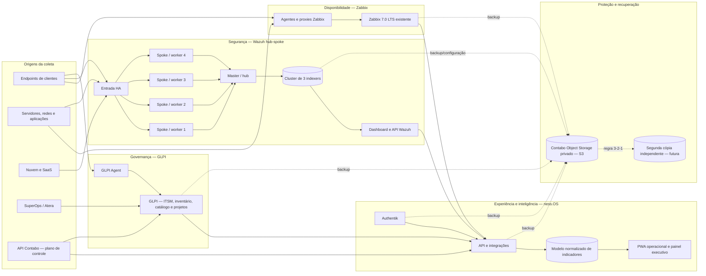
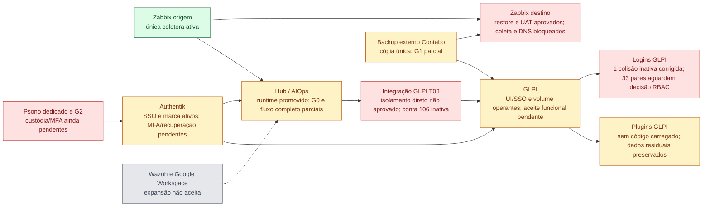

# Arquitetura oficial do ness.OS

- Estado: oficial
- Versão: 1.0
- Data: 22/08/2026
- Responsável: Ricardo Esper
- Decisões: ADR 0012 e ADR 0013

Este documento e a apresentação `docs/presentations/ness-os-infrastructure-5000-endpoints.html` formam a referência visual oficial do ness.OS. Diagramas anteriores permanecem apenas como histórico.

## Visão oficial

## Estado da implantação — 13/10/2026

Este diagrama mostra **estado comprovado**, não o desenho-alvo acima. Verde significa operação observada; amarelo, entrega parcial ou isolada; vermelho, gate bloqueado; cinza, expansão ainda não aceita. Uma seta indica dependência, não integração aprovada.

O destino Zabbix não está em produção; a origem segue coletando. No GLPI, a migração do volume e o retorno da rota pública não aprovam login nominal, ticket/anexo nem isolamento entre entidades. Os 33 pares de login ativos têm perfis divergentes, portanto a deduplicação em massa permanece suspensa. Os plugins não foram removidos. Evidências e próximos gates: [contexto canônico](../PROJECT_CONTEXT.md) e [plano master](../superpowers/plans/2026-10-12-ness-os-plano-master.md).

## Estado — 16/11/2026

O diagrama acima é a fotografia de 13/10. Desde então: o Zabbix novo assumiu a coleta em 15/11 (18 de 19 proxies; o antigo é ponte até o D+2, 17/11); n8n, Evolution e WhatsApp saíram em 16/11 (#250); o login do Hub passou ao Entra ID e o Authentik sai após o D+2.

### VPS (Contabo, região EU)

| VPS | Nome | IP | Papel |
| --- | --- | --- | --- |
| `vmi3532557` | `ness-os-zabbix-prd-01` | `169.58.234.9` | Zabbix 7.0 (servidor, banco e web) |
| `vmi3409271` | `ness-os-app-prd-01` | `144.91.115.242` | Hub, GLPI, Psono; Authentik até o D+2 |
| `vmi3409070` | `ness-os-wazuh-prd-01` | `144.91.72.202` | Zabbix antigo como ponte até o D+2; depois é recriada para o Wazuh |
| `npentest` | — | — | fora do ness.OS |

Rede privada da Contabo: não agora. Liga na recriação da `vmi3409070` e passa a ser necessária quando o Wazuh tiver mais de um nó (R3b).

### Clientes por fase

| Fase | Cliente | Escopo |
| --- | --- | --- |
| 1 | TBE | 300 endpoints |
| 1 | LTB | 190 endpoints |
| 1 | RZK Holding | 12 servidores e 250 estações |
| 1 | RZK Agro | 13 servidores |
| 1 | RZK Sol | 2 servidores |
| 2 | ABES | 18 endpoints |
| 2 | Artesano | 70 endpoints |
| 2 | EBN Group | 25 endpoints |
| 2 | Manesco | 160 endpoints |
| 2 | Numen | 400 endpoints |
| 2 | SCA | 27 servidores e 330 estações |
| 3 | Cavan | 127 endpoints e os servidores já no Zabbix |
| 3 | Target | 105 endpoints e os servidores já no Zabbix |
| 3 | Nova Energia | 54 endpoints |
| 3 | Comercial Esperança | 300 endpoints |
| 3 | Bichara | 8 endpoints |
| 4 | Alupar | 600 endpoints e todos os servidores existentes |

Total: 2.937 endpoints e estações e 54 servidores declarados, além dos servidores que Cavan, Target e Alupar já têm no Zabbix. RZK, ABES, Artesano, EBN, Manesco, SCA e Comercial Esperança ainda não existem no cadastro do Hub nem como entidade no GLPI; entram quando a fase começar. TNE e Unimed estão no cadastro e fora desta lista.

## Responsabilidade canônica

| Domínio | Sistema canônico | O que entrega ao ness.OS |
|---|---|---|
| Disponibilidade e capacidade | Zabbix | hosts, problemas, SLO, tendências, mapas e localização |
| Segurança | Wazuh | agentes, eventos qualificados, incidentes e postura |
| Governança e serviço | GLPI | ativos, tickets, catálogo, contratos, projetos e runbooks |
| Plano de controle do provedor | API Contabo | inventário de VPS, estado, ações, snapshots/backups e Object Storage |
| Experiência e indicadores | ness.OS | contexto unificado, correlação, PWA e visão executiva |
| Identidade | Entra ID (ADR 0015) | login OIDC e MFA; papel e tenant ficam no banco de cada sistema |

## Administração da plataforma

O papel `platform_admin` é o único autorizado a administrar tenants, integrações, credenciais, infraestrutura, políticas globais e ações do provedor. A atribuição inicial é nominal e restrita a:

- Ismael Araujo;
- Rogerio Salerno;
- Ricardo Esper.

O papel é atribuído no banco do Hub (`n_infraops_users`), conferido pelo backend e nunca ser inferido apenas pelo menu da interface. Toda ação privilegiada deve exigir autorização no servidor, MFA e trilha de auditoria. Clientes e demais equipes recebem papéis de consumo ou operação delegada por tenant, sem herdar `platform_admin`.

## CDN

Não foi identificado um serviço de CDN nativo da Contabo no catálogo/API consultados. CDN é opcional e fica somente diante dos ativos estáticos públicos da PWA e, se comprovado em piloto, como proteção HTTP. Não recebe tráfego de agentes Zabbix/Wazuh, APIs internas, sessões do GLPI/Authentik ou backups. Não entra na compra-base do projeto.

## Backup S3

O Contabo Object Storage será a primeira cópia externa, acessada diretamente pela API S3 — nunca montada como disco do banco ou dos indexers. Padrão inicial de buckets privados:

- `ness-os-zabbix-prod`;
- `ness-os-aiops-prod`;
- `ness-os-glpi-prod`;
- `ness-os-wazuh-prod`;
- `ness-os-auth-prod`;
- `ness-os-evidence`.

Cada produtor terá credencial exclusiva, criptografia antes do envio, manifesto, SHA-256, marcador `COMPLETED`, versionamento/imutabilidade e lifecycle. A implantação continua bloqueada até existirem endpoint, access key, secret key e buckets reais; credenciais não serão inventadas nem documentadas no repositório.
