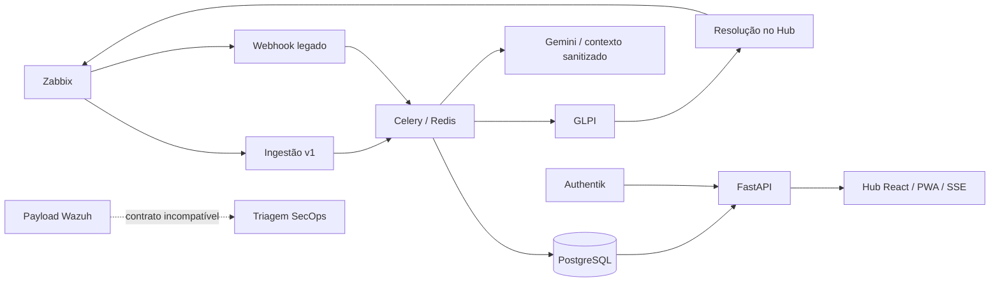

# Análise transversal do ness.OS — 17/09/2026

## Parecer

O ness.OS possui um núcleo AIOps implementado, controles de acesso relevantes e uma base de testes funcional. A evidência disponível sustenta a continuidade da consolidação do núcleo Zabbix–Hub–GLPI. Não sustenta declarar concluída a plataforma completa, o SOC ou a recuperação integral do ambiente.

O principal problema é a inconsistência entre contratos: dois caminhos de ingestão com garantias diferentes; formatos incompatíveis na triagem; observabilidade que consulta a fila errada; inicialização de banco diferente do estado evoluído; documentos executivos que contradizem evidências de implantação. A prioridade recomendada é corrigir essas fronteiras antes de ampliar funcionalidades.

## Escopo e limites

Revisão local do workspace, incluindo alterações ainda não commitadas. No levantamento, havia 70 arquivos rastreados modificados e 121 entradas não rastreadas. Essas alterações pertenciam ao estado anterior à análise.

Foram examinados arquitetura e ADRs, API, autenticação, RBAC, ingestão, workers, banco, integrações GLPI/Zabbix/IA, reconciliação de inventário, frontend, configuração de borda, Compose, IaC, CI e registros de recuperação. Foram executados testes locais e pequenas sondagens com dependências simuladas.

Esta análise é transversal; não representa inspeção linha a linha de todos os arquivos nem pentest. Não houve conexão administrativa às VPS, teste de carga, nova restauração de produção, homologação gráfica ou verificação das contas atuais. Registros de execução de 08/09 são evidência histórica, não medição de disponibilidade em 17/09. Não foram alterados código de aplicação, configurações operacionais ou serviços. O relatório é o único arquivo de documentação criado por esta análise.

## Arquitetura observada

| Camada | Implementação observada | Avaliação |
| --- | --- | --- |
| Experiência | React, TypeScript, Vite, PWA, SSE e consultas periódicas | Implementada; tipos e build aprovados; há falhas de apresentação de atualidade dos dados. |
| API e identidade | FastAPI, JWT, cookie HttpOnly, Authentik/OIDC, PKCE e RBAC | Controles reais; renovação/revogação durante streams exige tratamento. |
| Disponibilidade | Zabbix e clientes de API | Fonte canônica de disponibilidade; contrato v1 evoluiu além do legado. |
| ITSM e inventário | GLPI, reconciliação por identidade, tickets e solução | Integração implementada e documentada; não depende apenas de uma futura PoC. |
| Processamento | Celery, Redis e PostgreSQL | Filas e transações existem; falhas abruptas e observabilidade precisam de correção. |
| IA | Gemini, sanitização, contexto permitido e fallback | Proteções úteis; disponibilidade/cota atuais não foram medidas. |
| SOC | Endpoint de triagem, enriquecimento e módulo SecOps | Parcial; incompatibilidade de payload impede homologação. |
| Operação | Compose, Caddy, Ansible, Terraform, scripts e timers | Ferramentas extensas; reconstrução e release ainda fragmentados. |
| Recuperação e segredos | Backups locais/Restic, ensaios de restore e Psono | Evidência histórica substancial; MFA, recuperação individual e DR integral ainda exigem aceite. |

O diagrama descreve código e responsabilidades, não atesta que todas as integrações estejam ativas em produção.

## Achados prioritários

P1 indica correção prioritária antes de homologar ou ampliar o fluxo afetado. P2 indica fragilidade relevante para operação e manutenção. A prioridade não equivale a exploração comprovada em produção.

### 1. P1 — Triagem SOC ignora campos do payload recebido

O endpoint recebe `rule.level` e `agent.name`, mas o motor procura `level`/`rule_level` e `host`/`hostname` no primeiro nível. O endpoint também fornece inteligência em `ips`/`hashes`, enquanto o motor procura `abuseipdb`/`virustotal`/`misp` diretamente.

Uma sonda local com `rule.level=15`, agente `prod-dc` e inteligência maliciosa retornou `risk_score=0` e `ARCHIVE`. O endpoint transforma o arquivamento em `FALSE_POSITIVE` com confiança `1.0`. Isso converte ausência de leitura dos campos em certeza de falso positivo.

Evidência: `app/backend/app/core/triage_engine.py:99`, `:119`, `:144`; `app/backend/app/api/routers/secops.py:541`, `:561`, `:577`.

Correção proposta: normalizar o payload na fronteira; preservar severidade e evidências; distinguir baixa prioridade de falso positivo. Aceite: payload real de nível alto com inteligência maliciosa chega ao fluxo de análise, com teste do endpoint ao motor sem substituir o motor por mock. Incluir tenant no fingerprint e retirar dependência exclusiva de memória por processo para frequência.

### 2. P1 — Reentrega após morte do worker pode ser descartada

O worker v1 cria uma chave de inibição de 300 segundos antes de processar. Se a chave existe, retorna sucesso lógico como `deduplicated` sem consultar persistência. Há limpeza em exceções Python, mas uma morte abrupta do processo pode impedir essa limpeza. A configuração Celery pede reentrega após perda do worker; a reentrega durante o TTL encontra a chave e pode terminar sem completar o incidente.

A sonda confirmou que uma chave existente produz `deduplicated` sem executar o processamento. A morte abrupta de um worker real não foi simulada; o cenário completo decorre desse comportamento e da configuração de reentrega.

Evidência: `app/backend/app/workers/alerts.py:554`; `app/backend/app/workers/celery_app.py:43`.

Correção proposta: separar exclusão de processamento e conclusão persistida; chave ocupada deve permitir retry quando não existe conclusão comprovada. Aceite: interromper worker entre aquisição e commit em ambiente descartável; reentrega completa o incidente e mantém um único ticket GLPI.

### 3. P1 — Ingestão legada não coordena seus próprios locks

O receptor adquire `nessops:lock:<fingerprint>`. O worker primário libera e o worker diferido consulta `ninf:lock:<fingerprint>`. A sonda confirmou os nomes diferentes. O caminho diferido pode executar enquanto o primário ainda cria o incidente, com risco de corrida e conflitos de unicidade.

Evidência: `app/backend/app/core/locks.py:57`; `app/backend/app/workers/tasks.py:73`, `:122`; rota em `app/backend/app/api/webhooks.py`.

Correção proposta: estabelecer um contrato único de ingestão, preferencialmente adaptando o legado ao v1 após verificar consumidores. Se o legado continuar, unificar chave, propriedade e comportamento concorrente. Aceite: dois eventos concorrentes não iniciam duas criações e não perdem contagem.

### 4. P1 — Isolamento de tenant não é uniforme no inventário legado

O pipeline v1 restringe a busca de ativo por host e cliente. O legado busca por host **ou** hostname **ou** IP, sem filtro de cliente. A sincronização Atera também usa identidade do agente ou hostname sem tenant. Hostnames compartilhados podem associar o ativo errado; múltiplos candidatos podem gerar falha de consulta.

Evidência: `app/backend/app/workers/tasks.py:261`, `:373`, `:511`; contraste com `app/backend/app/workers/alerts.py:231` e `app/backend/app/integrations/cmdb_sync.py`.

Não foi demonstrado vazamento em produção. O risco decorre da consulta sem escopo e das atualizações executadas sobre o objeto encontrado.

Correção proposta: exigir identidade canônica e tenant em toda associação; rejeitar ambiguidades. Aceite: dois clientes com o mesmo hostname/IP não compartilham ativo, incidente ou atualização RMM.

### 5. P1 — Saúde e tamanho das filas podem produzir falsa normalidade

Os dois healthchecks de Celery no Compose terminam em `|| exit 0`; portanto, falha no comando de inspeção não torna o container unhealthy.

Há outro problema independente: `workers_health()` lê as listas das filas usando `redis_url`. Os defaults e `.env.example` colocam esse Redis no DB 0, enquanto o broker Celery está no DB 1. Na configuração fornecida, pode haver backlog real no broker e contagem zero no painel. Inspeção de consumidores e ledger de falhas continuam úteis, mas não corrigem essa leitura.

Evidência: `app/docker-compose.yml:63`, `:94`; `app/backend/app/integrations/pipeline_health.py:41`, `:48`; `app/.env.example:22`.

Correção proposta: falhar quando o worker não responde e medir a fila no broker correto, mantendo o ledger no Redis apropriado. Aceite: tarefa pendente no DB 1 aparece no painel; consumidor indisponível causa falha explícita.

### 6. P1 — Broker compartilha política de descarte de cache

O Compose usa uma única instância Redis com `--maxmemory 256mb --maxmemory-policy allkeys-lru` para cache, locks, filas e outros consumidores. Essa política permite remover chaves de fila/lock sob pressão de memória; separar apenas por DB lógico não separa o processo nem seu limite. Não há AOF explicitamente habilitado no comando.

Evidência: `app/docker-compose.yml:136`; `app/backend/app/config.py:21`; configuração Evolution no mesmo Compose.

Correção proposta: assegurar que filas não sejam descartadas como cache e definir persistência/recuperação do broker. A separação de instâncias é uma opção; o requisito é preservar entrega sob pressão e reinício. Aceite: ensaio de saturação e reinício com contagem de eventos aceitos, concluídos e pendentes.

### 7. P1 — Stream de incidentes preserva autorização antiga

O SSE autentica na abertura, copia role e tenant e entra em loop sem revalidar usuário, expiração ou mudança de autorização. Desativar o usuário protege novas requisições, mas não há encerramento explícito do stream já aberto. Uma conexão que permaneça ativa pode continuar recebendo eventos com a autorização anterior.

Evidência: `app/backend/app/api/routers/incidents.py:168`, `:185`; verificação de usuário em `app/backend/app/core/dependencies.py:96`.

Correção proposta: definir duração máxima e revalidação/revogação para conexões longas. Aceite: usuário desativado ou transferido de tenant deixa de receber eventos dentro de uma janela definida, inclusive sem recarregar a página.

### 8. P1 — Inicialização de banco não representa o schema atual

Os SQLs de inicialização usam `vector(768)`, mas o bootstrap habilita somente TimescaleDB. O SQL 002 altera `n_infraops_users`, cuja criação não aparece nos SQLs anteriores. `app.migrate` pressupõe o enum `userrole`. O enum de ativos do bootstrap não contém `unknown`, presente no modelo e em um SQL separado sob `infra/sql`.

Evidência: `app/backend/sql/000_init.sql:11`, `001_schema.sql:161`, `002_push_subscriptions.sql:7`; `app/backend/app/migrate.py:38`; `infra/sql/20260908_asset_type_unknown.sql`.

A divergência é confirmada estaticamente. Não foi iniciado PostgreSQL vazio nesta análise. Restaurar dump existente e instalar do zero são provas distintas; o restore documentado não elimina a lacuna de bootstrap.

Correção proposta: uma sequência versionada e reproduzível de migrations, incluindo extensões e identidade. Aceite: instalação em volume vazio e atualização da versão anterior chegam ao mesmo schema e passam no login, ingestão e reconciliação.

### 9. P2 — Painel executivo pode renovar timestamp sem atualizar dados

`CoreDashboard.refresh()` atualiza `updatedAt` mesmo quando as respostas HTTP não são bem-sucedidas. Os dados anteriores permanecem. A apresentação de KPI usa “fonte conectada” para `partial`, embora o backend use esse estado para degradação.

Evidência: `app/frontend/src/components/CoreDashboard.tsx:34`, `:69`; `app/backend/app/api/routers/core.py`.

Correção proposta: separar última tentativa, última coleta válida e estado de cada fonte. Aceite: HTTP 503 mantém o horário da última coleta válida e exibe erro/degradação em vez de confirmação de atualização.

### 10. P2 — Inteligência de vulnerabilidades é uma lista estática

`CVE_DATABASE` contém clientes afetados escritos diretamente no código; `/cve-intel` retorna data fixa de 06/07/2026. Não há nesse fluxo correlação de versão instalada com faixa vulnerável. Isso pode servir como catálogo editorial, mas não comprova vulnerabilidade atual de um ativo.

Evidência: `app/backend/app/api/routers/secops.py:31`, `:220`.

Correção proposta: separar aviso geral de achado validado; exigir ativo, versão observada, fonte e data da avaliação para afirmar exposição. A veracidade individual dos CVEs e das alegações regulatórias não foi investigada nesta revisão de código.

### 11. P1 operacional — Status executivo contradiz registros de execução

O documento de 17/09 diz que Psono não foi iniciado, escrita GLPI segue bloqueada e KVM8 pode continuar como ponte. O repositório contém implantação GLPI em 08/09, restauração Psono com aplicação e registro de KVM8 devolvida em 02/09. O mesmo status de 17/09 generaliza RPO/RTO, enquanto o relatório detalhado de recuperação ressalva o aceite integral.

Evidência: `docs/execution/project-stage-2026-09-17.md:84`, `:133`, `:206`; `docs/execution/hub-glpi-production-rollout-2026-09-08.md`; `docs/execution/recovery-verification-2026-09-08.md`; `docs/execution/hostinger-kvm8-retirement-readiness-2026-09-02.md`.

O status mais recente por data não deve ser tratado automaticamente como mais confiável. Correção proposta: consolidar uma matriz com requisito, evidência, data de coleta, proprietário, limitação e próximo aceite. Remover dependência de ativo devolvido e validar capacidade atual antes de qualquer decisão de infraestrutura.

## Pontos positivos a preservar

- Cookies HttpOnly/Secure/SameSite, validação de origem, PKCE e estado OIDC estão implementados.
- RBAC é aplicado no backend; rotas Contabo exigem `platform_admin` e usuários inativos são recusados em novas requisições.
- O v1 contém mapeamento de entidade GLPI, recusa ambiguidades, busca ticket por marcador e persiste incidente antes de publicar SSE.
- A resolução busca a solução autoritativa no GLPI e registra estado pendente de sincronização com Zabbix.
- Contexto de IA usa campos permitidos, sanitização e verificação de cliente para pós-incidente.
- O health score executivo permanece provisório, e Wazuh aparece como não configurado no Core, evitando uma falsa conclusão global.
- Existem imagens fixadas por digest, ações CI fixadas, secret scan, SBOM proposto e scripts de verificação com falha explícita.
- Os relatórios detalhados de recuperação delimitam corretamente o que os ensaios históricos provaram.

## Entrega, infraestrutura e manutenção

O deploy automático está desabilitado deliberadamente em `.github/workflows/deploy.yml`. Isso é uma contenção registrada, não uma falha a resolver simplesmente reativando o workflow. API e workers montam código local sobre a imagem: o digest da imagem sozinho não identifica todo o código executado. Somado às alterações não commitadas, isso dificulta reproduzir uma release a partir do Git.

O Terraform mantém `prevent_destroy=false` nas instâncias, e o playbook principal comenta a etapa de backup apesar de descrevê-la no fluxo. Esses artefatos precisam ser reconciliados com a operação atual antes de serem apresentados como reconstrução completa. Não foram executados Terraform, Ansible ou comandos de provisionamento.

O worker ML recebe somente `.env`, enquanto API e worker de alertas também recebem os arquivos externos GLPI/Zabbix. Isso exige conferir a distribuição efetiva dos segredos antes de homologar pós-incidente; o conteúdo desses arquivos não foi exposto ou auditado nesta análise.

A suíte atual usa muitos mocks e testes estáticos. Ela cobre regras importantes, mas não substitui banco limpo, broker real, concorrência, morte de processo ou jornada de navegador. Não há etapa de teste funcional de frontend no `package.json` ou CI frontend examinados.

## Verificação executada

| Verificação | Resultado desta análise |
| --- | --- |
| Backend `pytest` | 262 aprovados; 2 avisos. |
| Backend Ruff | Lint aprovado; 77 arquivos de aplicação formatados. |
| Backend Black | 111 arquivos sem alteração necessária. |
| Backend MyPy | 77 arquivos sem problemas reportados. |
| Frontend TypeScript | Aprovado. |
| Frontend Oxlint | Zero erros; um aviso de Fast Refresh em `useAuth.tsx`. |
| Frontend Vite | Build aprovado; JS principal de 312,23 kB, 91,16 kB gzip. |
| Infraestrutura | 11 scripts de teste aprovados; verificações estáticas e com comandos simulados. |
| Histórico operacional | 6 testes aprovados. |
| Sondas de contrato | Confirmados score zero para payload SOC, divergência de locks e descarte quando existe inibição. |

A primeira execução do backend teve 238 testes aprovados e 24 falhas por ausência local de `pywebpush`. A dependência já consta em `requirements.txt`; foi instalada em diretório temporário isolado e a suíte foi repetida com sucesso. A tentativa inicial de criar venv falhou porque `ensurepip` não estava disponível. Não foi alterada a lista de dependências do projeto.

A execução usou Python disponível no WSL e não recompôs integralmente a imagem de produção. Os resultados não atestam equivalência de todas as versões instaladas com o ambiente publicado. Nenhuma alegação de ausência de segredos ou vulnerabilidades de dependências é feita: scanners de segredos e de CVEs não foram executados nesta análise.

## Caminhos considerados

1. **Consolidar o núcleo existente — recomendado.** Corrigir ingestão, tenant, broker, saúde, sessões e migrations; reconciliar evidências; homologar o fluxo ponta a ponta. Menor escopo e benefícios diretamente ligados aos problemas demonstrados.
2. **Expandir SecOps em paralelo.** Pode ser feito em ambiente isolado depois da normalização do contrato; aumenta trabalho concorrente e não elimina os problemas do núcleo operacional.
3. **Reestruturar toda a plataforma agora.** Amplia migração e risco sem necessidade demonstrada. Os achados são majoritariamente de contrato e integração; não justificam uma reescrita geral.

## Ordem de trabalho e critérios de conclusão

1. **Estado confiável:** corrigir a matriz de situação, confirmar ativos autorizados e relacionar código implantado à release. Aceite: uma fonte de estado com evidências rastreáveis e sem dependência de KVM8 devolvida.
2. **Entrega e isolamento:** resolver reentrega, locks, tenant, Redis e medição de filas. Aceite: repetição, concorrência, morte de worker e indisponibilidade de GLPI sem perda silenciosa nem mistura de clientes.
3. **Identidade e reconstrução:** encerrar streams revogados e reproduzir instalação/migrations em ambiente vazio. Aceite: mudanças de acesso efetivas e reconstrução independente de estado manual não documentado.
4. **Experiência e SOC:** corrigir atualidade dos indicadores, separar catálogo de vulnerabilidades de evidência por ativo e normalizar Wazuh. Aceite: falha de fonte visível e alertas graves classificados corretamente.
5. **Operação homologada:** repetir restore e jornada de identidade, registrar capacidade, SLO, proprietários, rollback e observação nas datas reais. Aceite: evidências recentes, incluindo recuperação individual e serviços canônicos, sem extrapolar testes parciais.

Esses passos são propostas para revisão. Esta análise não implementa correções nem autoriza compras, cortes, notificações ou mudanças em produção.
