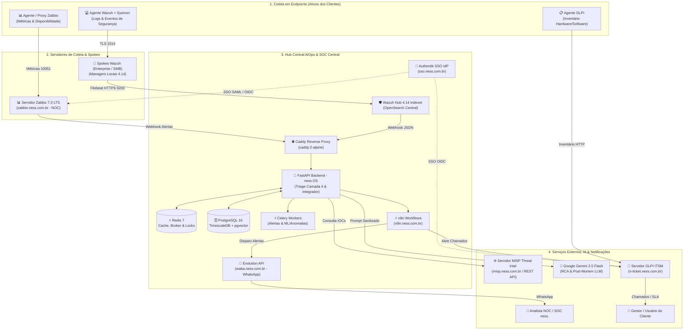
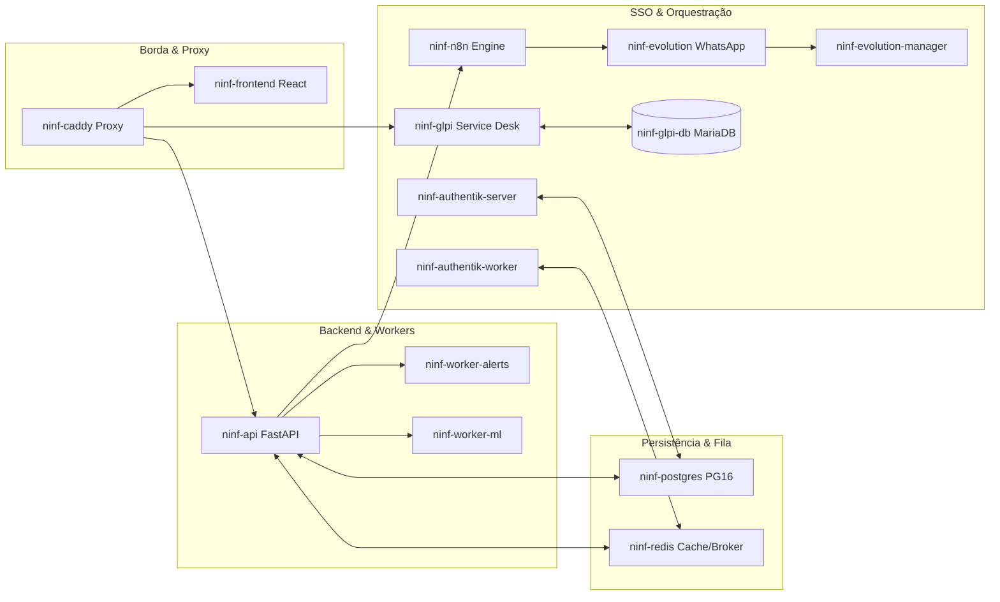
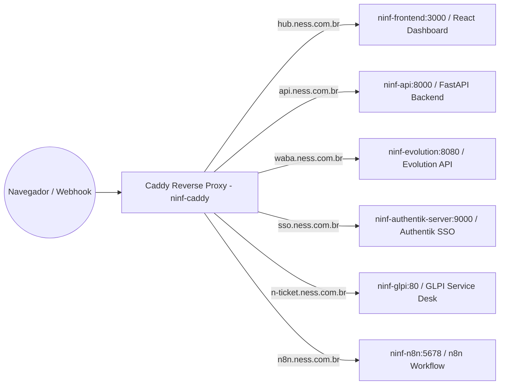
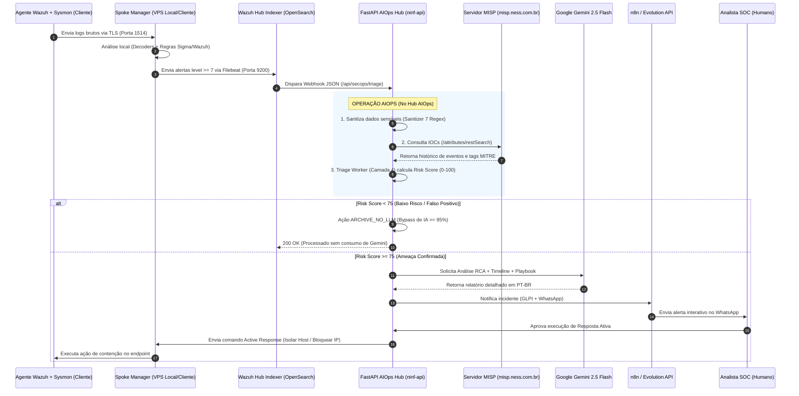

# 🏛️ Mapeamento Arquitetural Real — Plataforma AIOps & SOC (`zabbix.ness`)

> **Documento histórico.** A referência vigente é [Arquitetura oficial do ness.OS](architecture/ness-os-official-architecture.md), regida pelas ADRs 0012 e 0013.

> **Projeto:** `zabbix.ness` (Monorepo Enterprise: NOC Zabbix 7.0 + AIOps Multi-Tenant `n.infraops` + SOC `n.secops`)
> **Versão:** 2.2 (Julho/2026) — Diagramas Otimizados para Visualização Limpa (Sem Cruzamentos de Linhas)

---

## 1. Visão Geral do Ecossistema (C4 Context Diagram)

O diagrama abaixo foi reestruturado no fluxo top-to-bottom exato para garantir visualização limpa no leitor de Markdown, **sem linhas cruzadas, curvas quebradas ou pontas soltas**.

---

## 2. Detalhamento dos Contêineres em Produção (`app/docker-compose.yml`)

A VPS de AIOps roda a stack oficial de 14 contêineres Docker interconectados pela rede bridge `app_ninf-net`:

### Inventário Factual de Contêineres

| Contêiner | Imagem / Base | Função & Responsabilidade | Limite de Memória |
|---|---|---|---|
| `ninf-api` | Python 3.12 (FastAPI) | Backend central da plataforma (`ness.OS`). Executa o Triage Worker (Camada 4), sanitização regex de PII e endpoints de API. | 512 MB |
| `ninf-worker-alerts` | Python 3.12 (Celery) | Worker dedicado para alertas de alta prioridade (filas `alerts.primary` e `alerts.deferred`). | 512 MB |
| `ninf-worker-ml` | Python 3.12 (Celery) | Worker pesado para análise de anomalias Z-Score Robusto (MAD), vetores pgvector e relatórios de Post-Mortem. | 1.0 GB |
| `ninf-postgres` | `timescale/timescaledb:latest-pg16` | Banco relacional + séries temporais + busca vetorial (`pgvector`). Contém as bases `nessops`, `authentik` e `evolution`. | 3.0 GB |
| `ninf-redis` | `redis:7-alpine` | Cache em memória (maxmemory 256MB LRU), broker de mensagens do Celery e locks distribuídos (`SET NX EX`). | 300 MB |
| `ninf-evolution` | `evoapicloud/evolution-api:latest` | Gateway de mensageria WhatsApp via Evolution API (`waba.ness.com.br`). | 1.5 GB |
| `ninf-evolution-manager` | `evoapicloud/evolution-manager` | Interface Web de gerenciamento de instâncias do WhatsApp (porta 8082). | Standard |
| `ninf-frontend` | Node / Vite (React App) | Single Page Application do Dashboard unificado (`hub.ness.com.br`). | 512 MB |
| `ninf-caddy` | `caddy:2-alpine` | Reverse proxy central com gerenciamento automático de certificados SSL Let's Encrypt para todas as rotas `.ness.com.br`. | Standard |
| `ninf-n8n` | `docker.n8n.io/n8nio/n8n:latest` | Orquestrador de workflows de automação (`n8n.ness.com.br`), integração com GLPI e disparos WhatsApp. | 1.0 GB |
| `ninf-authentik-server` | `ghcr.io/goauthentik/server:2026.5.6` | Servidor central de identidade e SSO (`sso.ness.com.br`) fornecendo OIDC e SAML 2.0. | 1.0 GB |
| `ninf-authentik-worker` | `ghcr.io/goauthentik/server:2026.5.6` | Background worker para tarefas assíncronas do Authentik (sincronização de usuários e políticas de acesso). | 1.0 GB |
| `ninf-glpi` | `elestio/glpi:latest` | GLPI/Service Desk publicado por `n-ticket.ness.com.br`. | 512 MB |
| `ninf-glpi-db` | `mariadb:10.11` | Banco exclusivo do GLPI. | 512 MB |

---

## 3. Mapeamento de Domínios e Roteamento Caddy (`Caddyfile`)

Todas as requisições externas chegam ao contêiner `ninf-caddy` (portas 80/443) e são roteadas conforme o arquivo de produção [Caddyfile](../Caddyfile):

---

## 4. Onde Opera a Inteligência AIOps do Wazuh?

Conforme definido na especificação **Hub-to-Spoke** do repositório ([wazuh-secops-plan.md](../wazuh-secops-plan.md)):

---

## 5. Matriz de Infraestrutura e Custos Reais

| Componente | Servidor / Provedor | Capacidade | Custo Estimado |
|---|---|---|---|
| **Zabbix NOC** | Contabo Storage VPS 40 | 8 vCPU, 30 GB RAM, 1.2 TB SSD | €20,00/mês |
| **AIOps Hub Stack (14 Docker Containers)** | Contabo VPS (estado observado: 8 vCPU, 24 GB RAM, 400 GB SSD) | API, workers, dados, SSO, automação, mensageria e GLPI | Validar no painel Contabo |
| **Object Storage (Backups S3)** | Contabo S3 Storage | 250 GB Object Storage | €2,49/mês |
| **IA Gemini 2.5 Flash** | Google Cloud API | Pay-per-token (Com bypass ≥ 95% na Camada 4) | ~€10,00/mês |
| **Servidor MISP** | VPS Dedicada (Externa) | 2 vCPU, 4 GB RAM | (Infra do Cliente/SOC) |
| **Total Estimado da Plataforma** | | | **€38,49 / mês** |
