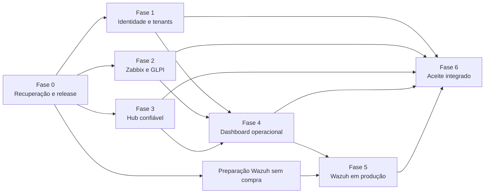

# ness.OS Full Operationalization Implementation Plan

> **For agentic workers:** REQUIRED SUB-SKILL: Use superpowers:subagent-driven-development (recommended) or superpowers:executing-plans to implement this plan task-by-task. Steps use checkbox (`- [ ]`) syntax for tracking.

**Goal:** Levar o ambiente atual do ness.OS a um estado operacional comprovado, com recuperação testada, identidade e isolamento validados, Zabbix e GLPI saneados, Hub confiável, dashboard fiel às fontes e Wazuh incorporado quando o gate de contratação for atendido.

**Architecture:** O Hub continua como plano de integração e experiência operacional. Zabbix, GLPI, Authentik, Psono, n8n, Contabo e Wazuh permanecem sistemas de registro de seus domínios; o Hub consome seus contratos, expõe saúde e frescor e nunca converte indisponibilidade em sucesso. Cada fase produz evidência, rollback e um gate que bloqueia dependências posteriores.

**Tech Stack:** Docker Compose, systemd, Bash, Python/FastAPI, Celery, Redis, PostgreSQL, React/Vite, Authentik/OIDC, Zabbix 7.0, GLPI, Psono, Contabo API, Restic/S3 e Wazuh 4.14.7.

**Spec:** `docs/architecture/ness-os-official-architecture.md`; avaliação de entrada em `docs/evaluations/ness-os-system-review-2026-09-17.md`; desenho do Wazuh em `docs/superpowers/specs/2026-09-18-wazuh-production-entry-design.md`.

## Global Constraints

- Preservar mudanças locais existentes; cada commit deve incluir somente os arquivos enumerados na tarefa.
- Não aplicar alterações diretas no banco de produção. Usar APIs, migrações versionadas ou ferramentas oficiais.
- Não registrar tokens, senhas, cookies, chaves, dumps ou conteúdo de segredos em logs e evidências.
- Executar primeiro em modo somente leitura ou dry-run; toda escrita em produção exige escopo, rollback e evidência anterior.
- Manter notificações externas desabilitadas durante testes sintéticos até o gate final.
- Toda métrica exibida no dashboard deve trazer fonte, instante de coleta, estado de frescor e erro explícito.
- Componentes ainda não implantados devem aparecer como `planned` ou `unavailable`, nunca como saudáveis.
- Usar a API da Contabo inicialmente somente para inventário, estado e reconciliação. Usar Object Storage da Contabo via S3/Restic com criptografia e bucket separado por domínio.
- Nenhuma contratação do Wazuh ocorre antes do gate de capacidade e custo da Fase 4; preparação de código e documentação pode ocorrer antes.
- Evidência operacional deve conter comandos, horários em UTC, resultado e referência da release, sem dados sensíveis.

---

## Estado de entrada confirmado em 2026-09-18

| Frente | Estado | Implicação |
|---|---|---|
| Hub/API/workers/Postgres/Redis | Serviços ativos e sondas privadas aprovadas | Pode ser refinado em voo, com rollout reversível |
| Backup do Hub | Falha recorrente por ausência de `docker0`; último conjunto completo em 2026-09-07 | Bloqueia mudanças de maior risco |
| Zabbix 7.0.27 | Operante com 259 hosts, mas backup local e remoto desabilitado e último conjunto em 2026-08-30 | Recuperação e saneamento são prioridade |
| Zabbix qualidade | 1.967 itens não suportados, 899 triggers desconhecidas, 240 hosts sem tags, 15 sem template e 1.321 problemas ativos | O dashboard não pode tratar o total bruto como saúde confiável |
| GLPI | Integração dry-run aprovada | Pode receber catálogo e teste sintético controlado |
| Authentik | Rotas públicas e SSO básico aprovados | Falta matriz completa de sessão, MFA, revogação e break-glass |
| Psono | Aplicação e backup saudáveis | MFA, recovery codes e emergency access ainda incompletos |
| Release | Produção sem checkout e árvore local com mudanças não consolidadas | Falta vínculo reproduzível entre código e runtime |
| Dashboard | Funciona, mas pode mostrar fonte conectada após erro e contém dados estáticos de segurança | Precisa de contrato de verdade operacional |
| Wazuh | Não implantado; DNS ausente; inventário Ansible obsoleto | Seguir pacote próprio depois do gate de compra |

## Sequência e dependências

## Planos por fase

| Fase | Plano | Gate de saída |
|---|---|---|
| 0 | `docs/superpowers/plans/2026-09-18-phase-0-recovery-release-baseline.md` | Backups recentes e restaurações aprovadas; release identificável e reversível |
| 1 | `docs/superpowers/plans/2026-09-18-phase-1-identity-tenant-controls.md` | Matriz de acesso, MFA, revogação e isolamento aprovados |
| 2 | `docs/superpowers/plans/2026-09-18-phase-2-zabbix-glpi-operations.md` | Fontes confiáveis e fluxo alerta-incidente-ticket idempotente |
| 3 | `docs/superpowers/plans/2026-09-18-phase-3-hub-runtime-reliability.md` | Saúde do runtime mede os componentes reais e rollout é reproduzível |
| 4 | `docs/superpowers/plans/2026-09-18-phase-4-dashboard-operational-truth.md` | Dashboard completo para o escopo implantado, com erro e frescor honestos |
| 5A | `docs/superpowers/plans/2026-09-18-wazuh-4147-production-rollout.md` | Wazuh 4.14.7 instalado, recuperável e estabilizado em ondas |
| 5B | `docs/superpowers/plans/2026-09-18-wazuh-security-signal-ingestion.md` | Sinais Wazuh chegam ao Hub sem duplicação e com compatibilidade para Wazuh 5 |
| 6 | `docs/superpowers/plans/2026-09-18-phase-6-integrated-acceptance.md` | Operação ponta a ponta aprovada e sustentada por sete dias |

## Regras de execução do programa

- [ ] Registrar o início de cada fase em `docs/execution/ness-os-operationalization-log.md`, com responsável, janela, release e rollback.
- [ ] Executar Fase 0 antes de qualquer alteração de esquema, autenticação, roteamento ou provisionamento.
- [ ] Após a Fase 0, executar Fases 1, 2 e preparação documental do Wazuh em paralelo somente quando não alterarem o mesmo serviço.
- [ ] Iniciar Fase 4 apenas quando os contratos das Fases 1, 2 e 3 estiverem aprovados.
- [ ] Obter cotação da VPS e Object Storage somente após estimar retenção com dados das fontes reais.
- [ ] Contratar a VPS do Wazuh após aprovação explícita do orçamento e do gate da Fase 4.
- [ ] Executar o aceite integrado com módulos ausentes explicitamente marcados; nenhum módulo planejado bloqueia o escopo já contratado se estiver isolado e descrito.
- [ ] Encerrar o programa somente com evidências de backup, restauração, autenticação, tenant, idempotência, observabilidade, rollback e operação por sete dias.

## Definição global de operacional

- [ ] Um operador autenticado vê estado, fontes, incidentes, ativos, tickets e backups autorizados para seu tenant.
- [ ] Uma falha de fonte aparece como falha ou dado obsoleto com horário da última coleta válida.
- [ ] Um alerta repetido não abre incidentes ou tickets duplicados.
- [ ] A revogação de sessão e a troca de papel passam a valer também em conexões de longa duração.
- [ ] Backups locais e externos respeitam RPO de 24 horas e têm restauração automatizada comprovada.
- [ ] Cada host monitorado possui tenant, tags, template e vínculo de inventário coerentes.
- [ ] Cada release em produção aponta para commit, imagens, configuração versionada e procedimento de rollback.
- [ ] Wazuh, quando contratado, opera em infraestrutura dedicada e entra por ondas de 5, 25 e até 50 endpoints.
- [ ] A equipe consegue executar os runbooks sem conhecimento implícito do autor da implementação.
