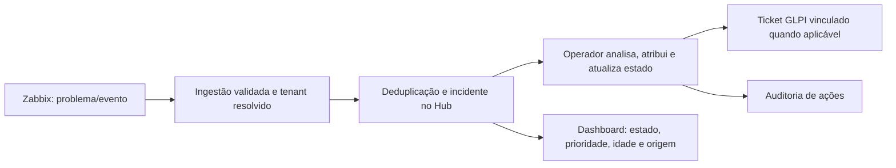

# Desenho de entrega do MVP e evolução do ness.OS

**Status:** proposta para revisão
**Data:** 27/09/2026
**Contexto:** organiza os planos por fase existentes em torno de uma entrega de produto utilizável, sem substituir a arquitetura oficial nem aprovar deploy de produção.

## Objetivo

Entregar o ness.OS como console operacional AIOps para que uma equipe autenticada acompanhe sinais do Zabbix, trate alertas como incidentes no Hub e acompanhe o ticket correspondente no GLPI. Após o MVP, ampliar cobertura funcional e integrar Wazuh como fonte de sinais de segurança por etapas controladas.

O MVP deve resolver um fluxo de trabalho completo para operadores. Uma integração aparecer como “conectada” ou um dashboard carregar não constitui entrega se os dados estiverem vencidos, não tiverem tenant ou não puderem ser rastreados até a origem.

## Decisões de escopo

1. Zabbix é a primeira fonte operacional do MVP; continua canônico para disponibilidade e capacidade.
2. O Hub é dono do ciclo e do contexto operacional do incidente, da deduplicação e do vínculo entre alerta e ticket.
3. GLPI permanece canônico para ativos e tickets; o Hub cria ou atualiza tickets apenas por integração aprovada e guarda o identificador externo.
4. Authentik é a identidade do operador. Autorização e tenant são validados no backend em cada operação.
5. Cada dado operacional expõe fonte, última coleta válida, frescor e erro. Falha de coleta não avança o horário de sucesso nem se apresenta como estado saudável.
6. A integração Wazuh é compatível com a arquitetura, mas a implantação do Wazuh não é requisito para aceitar o MVP.
7. A API Contabo permanece somente leitura neste escopo. Ações de infraestrutura e automação de remediação ficam fora do MVP.
8. Backups, recuperação, release reproduzível e rollback são gates de produção, não telas ou funcionalidades que substituam o fluxo de operador.

## Usuários e fluxo principal

O usuário primário é o operador NOC/SOC autenticado. Administradores configuram integrações e papéis; usuários de tenant veem somente os dados autorizados.

O fluxo tem que permitir: localizar o sinal original; entender severidade, host e tenant; reconhecer e atribuir o incidente; registrar decisão/comentário; acompanhar o ticket relacionado; perceber falha ou atraso da integração; e fechar o incidente sem perder o histórico.

## Escopo funcional do MVP

### Incluído

- Login SSO e logout usando Authentik, com papéis e tenant impostos no backend.
- Lista de incidentes com busca/filtros operacionais básicos, prioridade, estado, idade, origem, tenant autorizado e link de origem.
- Detalhe do incidente com eventos correlacionados, histórico de estado, atribuição, comentário e ticket GLPI relacionado.
- Ingestão de sinais Zabbix no Hub, com validação, mapeamento explícito de tenant e chave idempotente estável.
- Criação/atualização do ticket GLPI para o fluxo aprovado; falhas ficam visíveis e recuperáveis, sem duplicar tickets em retry.
- Dashboard mínimo para saúde das fontes e fila de incidentes: valor, fonte, instante da coleta, estado de frescor e erro.
- Trilha de auditoria para autenticação relevante, mudança de estado, atribuição e ação de integração.
- Estados explícitos para fontes indisponíveis, dados obsoletos, fila em atraso e módulos planejados.

### Fora do MVP

- Wazuh em produção, agentes de endpoint e resposta automática de segurança.
- Remediação automática de host, rede ou cloud; comandos privilegiados do provedor.
- Cobertura completa dos módulos executivos, mapas customizados, relatórios avançados e personalização por cliente.
- Migração de todos os fluxos legados, toda a taxonomia histórica ou saneamento integral do backlog Zabbix.
- Alta disponibilidade inicial do Wazuh, implantação simultânea de centenas de endpoints ou migração de histórico entre versões principais.

## Critérios de aceite do MVP

1. Operadores autenticados executam o fluxo alerta Zabbix → incidente Hub → ticket GLPI em um tenant de teste, com evidência dos identificadores relacionados.
2. Reentrega do mesmo sinal e retry após falha não criam incidente nem ticket duplicado.
3. Um usuário não lê nem altera incidentes, sinais ou tickets de outro tenant, mesmo chamando a API diretamente.
4. Falha de Zabbix, Hub worker ou GLPI é visível com fonte, último sucesso e erro; não vira lista vazia ou status saudável.
5. Mudanças de estado, atribuição e integração deixam histórico atribuível ao usuário/serviço.
6. Testes automatizados dos contratos críticos, build frontend e verificações de lint aplicáveis passam na release candidata.
7. A release candidata possui commit e imagens identificáveis, backup/restore aplicável comprovado, procedimento de rollback e execução canário antes de promoção.
8. O aceite de produção ocorre apenas quando os gates de segurança, recuperação e release da Fase 0 e os contratos das Fases 1–3 estiverem aprovados.

## Rota de entrega

### Etapa A — fundação e risco de produção

Concluir o gate Fase 0: recuperação testada, identidade nominal e release/rollback reproduzíveis. Desenvolvimento local pode avançar em paralelo, mas a implantação do MVP permanece bloqueada até esse gate.

### Etapa B — fluxo operacional vertical

Completar os controles da Fase 1 necessários ao MVP e o fluxo da Fase 2 de qualidade Zabbix/GLPI. Fechar a confiabilidade de runtime, idempotência e retry da Fase 3. A unidade de entrega é o percurso utilizável pelo operador, não a conclusão isolada de tarefas de infraestrutura.

### Etapa C — interface MVP

Executar a Fase 4 somente sobre os contratos aprovados: lista/detalhe de incidentes, vínculo de ticket, estado das fontes e frescor. Dados estáticos não podem simular capacidades ainda indisponíveis; módulos fora do escopo ficam marcados como planejados ou indisponíveis.

### Etapa D — piloto e aceite

Executar aceite integrado da Fase 6 por persona e tenant com eventos sintéticos identificáveis. Fazer canário, validar rollback e observar sete dias conforme o gate do projeto. Promover somente após aceite, sem ampliar o escopo no meio do piloto.

## Evolução após o MVP

### Pós-MVP 1 — operação diária

- Melhorar busca, filtros, atribuição em lote, notas e painéis por função, guiados por uso observado.
- Expandir cobertura de ativos, catálogo, runbooks e qualidade de dados Zabbix/GLPI em ondas.
- Acrescentar métricas de carga, tempos de triagem/resolução, backlog e falha de integração com definições explícitas.

### Pós-MVP 2 — Wazuh como fonte de segurança

- Preparar infraestrutura dedicada e aprovar custo/capacidade antes da contratação, conforme o gate já definido.
- Começar na versão e baseline do plano Wazuh aprovado; o adapter mantém detalhes da versão fora do modelo do Hub.
- Ingerir sinais por endpoint autenticado, persistir antes do processamento assíncrono, resolver tenant por mapeamento confiável e deduplicar por identidade estável.
- Iniciar em modo de observação com cinco endpoints. Não despachar automaticamente para GLPI, n8n, IA ou notificações nesta onda.
- Avançar para 25 e no máximo 50 endpoints da primeira onda somente após gates de isolamento, perdas, duplicidade, desempenho e restore.
- Após evidência do piloto, habilitar decisão operacional humana e vínculo de incidente/ticket segundo política; automatização de resposta é outro gate e outro plano.

### Pós-MVP 3 — expansão controlada

Expandir integrações, visão executiva, automações e volume por casos de uso medidos. Cada expansão deve possuir owner, sinal de sucesso, limite de blast radius, modo de observação/dry-run quando aplicável, rollback e evidência de tenant. Não incluir operação avançada apenas por estar prevista na arquitetura futura.

## Relação com os planos existentes

- Fase 0 continua gate de produção; não é redefinida por este desenho.
- Fases 1, 2 e 3 implementam identidade, fontes e confiabilidade necessárias ao fluxo vertical.
- Fase 4 implementa a interface e a verdade operacional do MVP.
- Fase 6 fornece o aceite integrado, canário e observação sustentada.
- Fase 5A/5B (Wazuh rollout e ingestão) passa a ser explicitamente pós-MVP, mantendo a preparação sem compra permitida antes do gate.

Os planos existentes são a fonte de detalhes de tarefas por componente. Antes da execução, devem ser reconciliados com este escopo: duplicatas removidas, gates e dependências preservados, testes e interfaces explícitos, e cada tarefa ligada a um critério de aceite. Não marcar tarefas operacionais históricas como trabalho de produto entregue sem evidência do fluxo do operador.

## Riscos e limites

- O gate Fase 0 atualmente aparece como pendente; logo, é possível avançar em implementação e testes locais, mas não declarar o MVP implantado.
- O Wazuh não está implantado e depende de DNS, inventário atualizado e aprovação de capacidade/custo; sua entrada no MVP aumentaria prazo e risco sem ser necessária ao fluxo Zabbix/GLPI.
- A qualidade de dados fonte pode limitar o piloto. O escopo deve selecionar um conjunto conhecido de hosts e eventos, registrar limitações e impedir que totais brutos sejam apresentados como saúde.
- Automação baseada em IA não decide tenant, severidade final ou ação privilegiada; decisões e contexto usados precisam ser auditáveis e limitados por política.

## Não objetivos

Este desenho não aprova contratação, mudança de produção, alteração de esquema ou escrita nas instâncias externas. Ele define uma rota de produto para revisão e servirá como base dos planos executáveis após aprovação.
